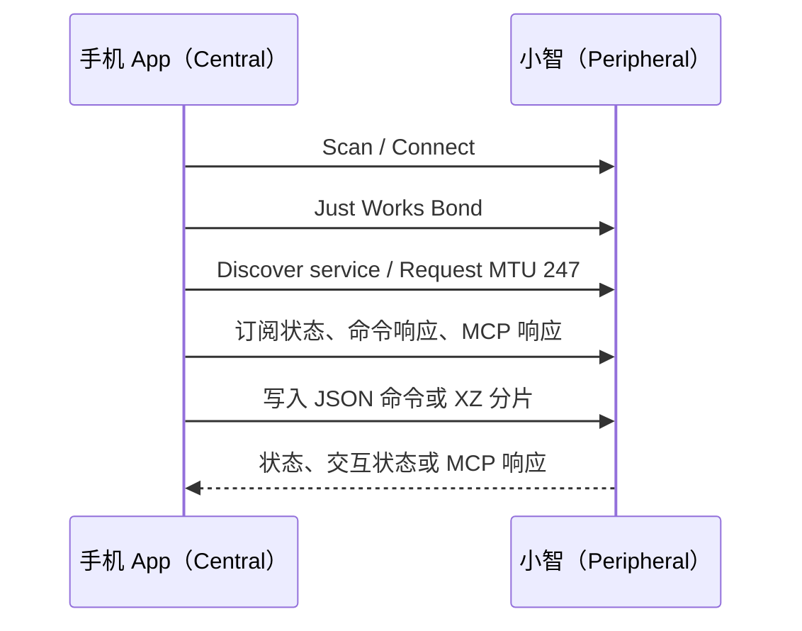

# 小智 BLE 接入与主动语音文档

本文档面向将小智接入 vvewell Android/Flutter App 的开发者，描述当前仓库内 Android BLE SDK、Flutter 桥接和主动语音能力的接入方式。

## 1. 能力与边界

小智是 BLE 外设（Peripheral），手机 App 是 Central。当前接口支持：

- 扫描、配对、连接与断线重连；
- Wi-Fi 配网、设备状态、系统信息、音量和亮度控制；
- 云端语音交互、直接文本对话和 MCP 工具调用；
- 心率/血氧异常主动语音提醒；
- 连接问候、整点问候和自定义定时问候。

固件使用 BLE protocol v3，长消息帧使用 XZ frame v1。所有应用载荷均为 UTF-8 JSON。

> 当前固件只保留一个活动 Central 连接。因此 App 不应同时通过多个 BLE 客户端连接同一台小智。

## 2. 工程结构

| 组件 | 路径 | 职责 |
| --- | --- | --- |
| Android SDK | `hardware/xiaozhi/xiaozhi-ble-sdk/xiaozhi-ble` | BLE 扫描、配对、GATT 串行队列与 MCP 响应重组 |
| Android Flutter Host | `android/app/src/main/kotlin/com/alloop/blue/test/MainActivity.kt` | 将 SDK 暴露给 Flutter Method/Event Channel |
| Flutter 仓库 | `lib/features/xiaozhi/data/xiaozhi_ble_repository.dart` | Flutter 对小智 BLE 能力的唯一入口 |
| 主动语音服务 | `lib/features/xiaozhi/services/xiaozhi_proactive_voice_service.dart` | 健康提醒和定时问候调度 |
| 设备页 | `lib/features/xiaozhi/presentation/pages/xiaozhi_device_detail_page.dart` | 连接、控制与主动语音设置 UI |

Android App 已通过 Gradle 引入 SDK：

```kotlin
implementation(project(":xiaozhi-ble"))
```

## 3. Android 前置条件

### 3.1 Manifest 与运行时权限

Android 12（API 31）及以上需要：

```xml
<uses-permission
    android:name="android.permission.BLUETOOTH_SCAN"
    android:usesPermissionFlags="neverForLocation" />
<uses-permission android:name="android.permission.BLUETOOTH_CONNECT" />
```

Android 6 至 11 扫描通常需要 `ACCESS_FINE_LOCATION`，并且系统定位服务必须打开。SDK 可用以下方法得到应请求的权限：

```kotlin
requestPermissions(XiaoZhiBlePermissions.requiredForFullUse(), 1001)
```

vvewell 的 `AndroidManifest.xml` 已声明上述权限；接入方仍需在运行时请求并检查授权结果。

### 3.2 安全与配对

- 控制类特征要求加密链路；
- 配对方式为 Just Works，并保存 Bond；
- 首次连接或删除系统蓝牙配对记录后，必须重新完成配对；
- 看到 `ATT 0x05 / Insufficient Authentication` 时，断开连接、删除系统中旧的 `XIAOZHI-*` 配对记录，再重新连接。

不要为规避配对而关闭固件端加密。BLE 接口可以修改 Wi-Fi、调用设备工具和重启设备。

## 4. 发现、连接与订阅

小智广播名称为 `XIAOZHI-<MAC 后四位>`，例如 `XIAOZHI-ABCD`。推荐主动扫描，并以服务 UUID 过滤为主、名称前缀兼容为辅。

主服务 UUID：

```text
4fafc201-1fb5-459e-8fcc-c5c9c331914b
```

Android SDK 的最小接入示例：

```kotlin
val ble = AndroidXiaoZhiBleClient(applicationContext)
val device = ble.scan().firstOrNull {
    it.name?.startsWith("XIAOZHI", ignoreCase = true) == true
} ?: error("未发现小智")

ble.connect(device)
// connect() 已完成 Just Works 配对、服务发现、MTU 请求和 Notify 订阅。
val systemInfo = ble.readSystemInfo().raw
```



SDK 会把 GATT 操作放入一个串行队列。不要绕过 SDK 直接并发读写 `BluetoothGatt`。

## 5. GATT 服务表

| 名称 | UUID | 属性 | 方向 | 用途 |
| --- | --- | --- | --- | --- |
| Wi-Fi 配置 | `4fafc202-1fb5-459e-8fcc-c5c9c331914b` | Read, Write | 双向 | 写入 SSID/密码，读取连接状态 |
| 设备状态 | `4fafc203-1fb5-459e-8fcc-c5c9c331914b` | Read, Notify | 设备 → App | 状态快照与状态变化 |
| 命令 | `4fafc204-1fb5-459e-8fcc-c5c9c331914b` | Write | App → 设备 | 兼容命令、文本对话和 MCP 请求 |
| 命令响应 | `4fafc205-1fb5-459e-8fcc-c5c9c331914b` | Notify | 设备 → App | 短响应、交互状态 |
| 系统信息 | `4fafc206-1fb5-459e-8fcc-c5c9c331914b` | Read | 设备 → App | 芯片、MAC、Flash 与 Wi-Fi 信息 |
| 长响应流 | `4fafc207-1fb5-459e-8fcc-c5c9c331914b` | Notify | 设备 → App | MCP 和过长 JSON 响应，使用 XZ v1 分片 |

三个 Notify 特征都必须订阅。CCCD UUID 为 `00002902-0000-1000-8000-00805f9b34fb`，启用 Notify 写入 `01 00`。

## 6. Flutter 接入

Flutter 使用以下通道：

```text
MethodChannel: alloop/xiaozhi_ble
EventChannel:  alloop/xiaozhi_ble/events
```

使用仓库类，避免页面直接访问平台通道：

```dart
final repository = XiaoZhiBleRepository();
final devices = await repository.scan();
final device = devices.first;

await repository.connect(device);
final info = await repository.readSystemInfo();
await repository.sendCommand('set_volume', '{"volume":70}');

final events = repository.events.listen((event) {
  switch (event['kind']) {
    case 'connection':
      // state: disconnected / connecting / pairing / ready / failed
      break;
    case 'deviceStatus':
    case 'commandResponse':
    case 'mcpResponse':
    case 'connectionLost':
      break;
  }
});
```

`events` 是共享广播流。主动语音服务和设备页可同时监听，不会重复注册或覆盖 Android EventChannel。

## 7. 常用命令

所有命令写入命令特征，并使用统一格式：

```json
{
  "command": "set_volume",
  "params": {
    "volume": 70
  }
}
```

| 命令 | 参数 | 说明 |
| --- | --- | --- |
| `get_ble_capabilities` | `{}` | 连接后优先调用，获取固件能力和协议版本 |
| `get_device_status` | `{}` | 获取完整设备状态 |
| `get_system_info` | `{}` | 获取系统信息 |
| `set_volume` | `{"volume":0..100}` | 设置音量 |
| `set_brightness` | `{"brightness":0..100}` | 设置亮度；无背光设备会失败 |
| `toggle_chat` | `{}` | 切换对话 |
| `start_listening` / `stop_listening` | `{}` | 开始或停止聆听 |
| `get_wifi_scan` | `{}` | 发起 Wi-Fi 扫描；结果可能通过长响应返回 |
| `enter_wifi_config` | `{}` | 进入 Wi-Fi 配网（仅支持的板型） |
| `reboot` | `{}` | 返回成功响应后异步重启 |

Wi-Fi 配置写入值：

```json
{
  "ssid": "OfficeWiFi",
  "password": "secret"
}
```

## 8. 直接文本对话与语音

### 8.1 `send_text`

`send_text` 会将文本送入小智的云端对话与 TTS 链路，是 App 让小智主动说话的标准方式。

```dart
await repository.sendText(
  requestId: 'greeting-1722744000000',
  text: '请用简短温暖的中文向用户问候，并提醒他适量喝水。',
);
```

其实际 BLE 命令如下：

```json
{
  "command": "send_text",
  "params": {
    "request_id": "greeting-1722744000000",
    "text": "请用简短温暖的中文向用户问候，并提醒他适量喝水。"
  }
}
```

约束：

- `request_id` 必须为 1 至 64 个字节，仅使用字母、数字、`.`、`_`、`-`；
- `text` 非空，固件上限为 1024 UTF-8 字节；
- 同一连接的 active + pending 文本请求最多为 4 条；
- App 必须监听 `interaction_status`，不要把 GATT Write 成功当作播报完成。

状态流转：

```text
accepted → sent → completed
```

失败状态为 `failed`，常见错误码包括 `busy`、`queue_full`、`network_unavailable`、`send_failed`、`queue_timeout`、`response_timeout` 和 `interrupted`。

### 8.2 带提示词的语音聆听

`start_listening_with_prompt` 适用于让用户说话后再由小智继续对话：

```json
{
  "command": "start_listening_with_prompt",
  "params": {
    "request_id": "voice-1722744000000",
    "prompt": "请用一句话询问用户今天感觉如何。"
  }
}
```

该请求的状态通常为 `accepted → started`。当前固件不会为该语音请求发送 `completed`，需要通过设备状态、TTS 状态或后续交互判断结束。

### 8.3 长消息与 XZ 分片

请求 MTU 247 后，单个 ATT Write 的有效载荷通常不超过 244 字节。超过单包容量的命令必须按 UTF-8 原始字节使用 XZ v1 分片：

```text
Offset  0..1: "XZ"
Offset  2:    版本 1
Offset  3..4: message_id（uint16，大端）
Offset  5..6: chunk_count（uint16，大端）
Offset  7..8: chunk_index（uint16，大端，从 0 开始）
Offset  9..N: JSON 的 UTF-8 字节片段
```

每个分片必须等待前一个 Write Response 成功后再发送，且同一条逻辑命令的分片不能与其他命令交错。

当前仓库中的 Android SDK 已自动重组来自 `4fafc207` 的 MCP 长响应；若业务要发送超出单个 ATT Write 容量的上行文本/命令，应在发送端补充分片编码后再写入。

## 9. MCP 工具调用

MCP 是能力可发现的优先控制入口：

```dart
await repository.initializeMcp();
await repository.listMcpTools();
await repository.callMcpTool(
  'self.audio_speaker.set_volume',
  '{"volume":70}',
);
```

接入流程：

1. 调用 `initializeMcp()`；
2. 调用 `listMcpTools()`；
3. 仅调用列表实际返回的工具；
4. 从 `mcpResponse` 事件中读取 JSON-RPC 响应。

屏幕、摄像头、电池与传感器等均为板型可选能力，不能仅凭 UUID 假设其存在。

## 10. 主动语音与健康提醒

主动语音服务在 App 启动时初始化，并订阅本地健康库的 `LocalHealthDatabase.vitalReadingStream`。只有小智连接状态为 `ready` 时才会发送 BLE 文本对话。

默认策略：

| 场景 | 行为 |
| --- | --- |
| 小智刚连接成功 | 非免打扰时间发送一次欢迎问候 |
| 每个整点 | 发送一次简短时段问候 |
| 自定义时间 | 以 `HH:mm, HH:mm` 形式配置额外问候 |
| 心率 ≤ 50 bpm | 主动关怀、建议静息后复测 |
| 心率 ≥ 120 bpm | 主动关怀、建议静息后复测 |
| 血氧 ≤ 92% | 主动关怀、建议静息后复测 |
| 同类健康提醒 | 默认 15 分钟冷却，防止连续播报 |

健康提醒还会执行以下保护：

- 忽略无效记录、调试模拟数据以及明显不可信的数值；
- 仅接受心率 30 至 220 bpm、血氧 70% 至 100% 的有效测量范围；
- 最多保留 4 条未完成文本对话；
- 普通问候默认避开 22:00 至次日 07:00；健康异常提醒不受该免打扰时间限制；
- 提示词要求小智不作诊断、不制造恐慌，并建议持续异常或明显不适时咨询专业医疗人员。

设备页“主动语音关怀”卡片可以打开/关闭功能、配置阈值、调整冷却时间和定时时间，并提供“现在问候”测试按钮。当前这些设置保存在 App 进程内，重启 App 后恢复默认值；如需持久化，应将 `ProactiveVoiceConfig` 写入应用设置。

> 当前调度器依赖 App 进程存活与 BLE 连接保持。若需要锁屏、被系统回收或 App 完全退出后仍定时播报，需要增加 Android 前台服务、精确闹钟和相应的系统权限策略。

## 11. 调试与验收

建议按以下顺序联调：

1. 确认系统蓝牙打开，授予扫描和连接权限；
2. 扫描到 `XIAOZHI-*` 后连接，等待 `connection.state == ready`；
3. 调用 `get_ble_capabilities`，记录 `protocol_version` 与 `interaction` 能力；
4. 发送短 `set_volume` 命令，确认 `commandResponse`；
5. 发送 `send_text`，确认收到 `accepted`、`sent`、`completed`；
6. 在小智设备页点击“现在问候”，确认小智实际播报；
7. 写入一条有效的异常健康记录，确认在冷却窗口外只触发一次健康提醒；
8. 断开小智后确认 App 不再尝试发送主动对话。

常见问题：

| 现象 | 排查方式 |
| --- | --- |
| 扫描不到设备 | 检查蓝牙、运行时权限、Android 6–11 的定位服务，以及 `XIAOZHI-` 名称前缀 |
| 连接后读写返回 `0x05` | 删除旧 Bond 后重新配对，等待 `ready` 再读写 |
| Write 成功但没有播报 | 继续监听 `interaction_status`；检查设备网络与 `network_unavailable` / `send_failed` |
| 主动提醒没有触发 | 检查小智连接是否 `ready`、主动语音开关、健康记录是否有效、是否仍在冷却期 |
| 定时问候未触发 | 确认 App 未被系统结束、BLE 仍连接、当前不在普通问候免打扰时段 |

## 12. 相关文件

- Android SDK README：`hardware/xiaozhi/xiaozhi-ble-sdk/README.md`
- 协议常量：`hardware/xiaozhi/xiaozhi-ble-sdk/xiaozhi-ble/src/main/java/com/xiaozhi/ble/XiaoZhiBleProtocol.kt`
- Flutter 仓库：`lib/features/xiaozhi/data/xiaozhi_ble_repository.dart`
- 主动语音服务：`lib/features/xiaozhi/services/xiaozhi_proactive_voice_service.dart`
